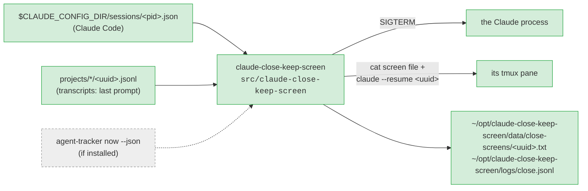

# claude-close-keep-screen

**Close running Claude Code sessions to free memory, leaving each one resumable in its own tmux pane: by hand, or the ones idle for longer than N hours.**

## The big picture



<sub>green = live · dashed = planned (agent-tracker v1 is being built)</sub>

## The two commands

| Command | What it does |
|---|---|
| `claude-close-keep-screen close <uuid \| uuid prefix \| %pane>` | closes one Claude session (was `asm close`) |
| `claude-close-keep-screen idle --over <hours> [--dry-run]` | lists the Claude sessions that are idle and whose last prompt is older than `<hours>`, and closes them (`--dry-run`: only lists, with the safety checks' answer) |

A close, step by step:

```text
safety checks ──► capture the pane ──► SIGTERM ──► screen file ──► pane: cat screen file, then "claude --resume <uuid>" typed (press Enter to resume)
(refused: nothing touched)          (no exit in 5 s: stop, pane untouched)
```

| The session | What a close does |
|---|---|
| in a tmux pane | the steps above: its screen stays, `claude --resume` typed |
| attached to no terminal (non-interactive, background) | a plain SIGTERM after the same safety checks: there is no screen to keep (the user, 2026-11-19) |
| in a terminal outside tmux | refused: SIGTERM would wipe its screen, and nothing can be typed back into it |

**Scheduler: none yet.** When `idle` should run (every hour? at night? which N?) is not decided; for now it runs by hand.

## Folder map

```text
claude-close-keep-screen/
├── AGENTS.md            rules for agents (Claude and Codex), vocabulary
├── README.md            this page
├── TESTING.md           how to run the tests
├── install.sh           → ~/opt/claude-close-keep-screen/bin/claude-close-keep-screen, link ~/.local/bin/claude-close-keep-screen
├── uninstall.sh         removes both (keeps data/ and logs/)
├── src/claude-close-keep-screen the command (Python 3, one file)
└── tests/
    ├── run_tests.sh     the tests, in a sandbox (own HOME, own tmux server)
    └── fake_claude.py   a fake Claude process the tests close
```

---
Rules for agents: [`AGENTS.md`](AGENTS.md)
